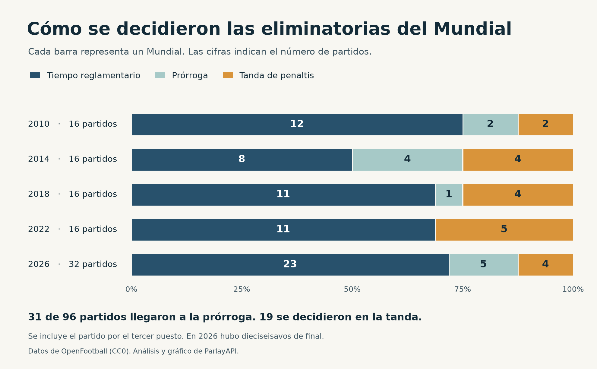

# Cómo se decidieron las eliminatorias del Mundial

En los cinco Mundiales masculinos disputados entre 2010 y 2026, 31 de los 96 partidos de eliminación directa terminaron empatados al cabo del tiempo reglamentario. Doce se resolvieron en la prórroga y 19 en la tanda de penaltis. El recuento incluye los partidos por el tercer puesto.

[Descargar el gráfico en PNG](https://raw.githubusercontent.com/JacobiusMakes/parlayapi-notebooks/main/press/eliminatorias-del-mundial.png) · [Descargar los 360 partidos en CSV](https://github.com/JacobiusMakes/parlayapi-notebooks/releases/download/world-cup-scorelines-v1/matches.csv) · [English edition](world-cup-knockout-results.md)

| Mundial | Partidos de eliminación directa | Resueltos en el tiempo reglamentario | Resueltos en la prórroga | Resueltos en la tanda |
|---:|---:|---:|---:|---:|
| 2010 | 16 | 12 | 2 | 2 |
| 2014 | 16 | 8 | 4 | 4 |
| 2018 | 16 | 11 | 1 | 4 |
| 2022 | 16 | 11 | 0 | 5 |
| 2026 | 32 | 23 | 5 | 4 |

**Pie de gráfico.** Las barras muestran qué proporción de los partidos se decidió en cada fase. Los números dentro de las barras indican partidos. En 2026 se añadieron los dieciseisavos de final, por lo que el total pasó de 16 a 32.

**Cómo citar un marcador.** Argentina y Francia terminaron los 90 minutos de la final de 2022 con un 2–2. Al acabar la prórroga iban 3–3. Argentina ganó la tanda por 4–2. Los goles de la tanda se registran por separado. El tiempo reglamentario incluye el descuento.

**Nota de edición.** En un ejemplo ficticio, una fuente dice «first-half score, 1–0». Traducirlo como «marcador al final del tiempo reglamentario, 1–0» cambia el período. La traducción que conserva el dato es «marcador al descanso, 1–0». Para publicar el marcador tras los 90 minutos hace falta un registro de ese período.

**Créditos.** Datos de [OpenFootball](https://github.com/openfootball/worldcup.json/tree/516d3825c3bd23fdc298c4014e84bde78f2d4965), publicados bajo CC0. Análisis y gráfico de ParlayAPI. Para reproducirlo, ejecute [chart.py](../labs/world-cup-scorelines/chart.py) con la opción `--language es` junto a la base SQLite del proyecto.
