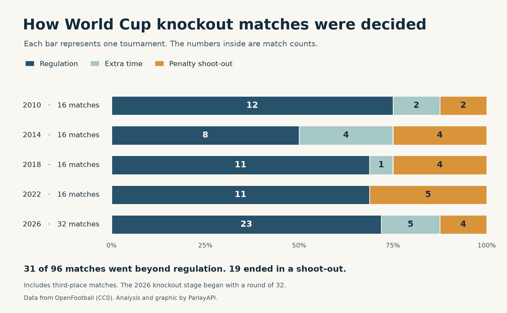

# How World Cup knockout matches were decided

Across the five men's World Cups from 2010 through 2026, 31 of 96 knockout matches were level after regulation. Twelve were decided in extra time, and 19 reached a penalty shoot-out.

[Download the 1,980 × 1,224 PNG](https://raw.githubusercontent.com/JacobiusMakes/parlayapi-notebooks/main/press/world-cup-knockout-results.png) · [Open the underlying match records](../labs/world-cup-scorelines/README.md)

**Caption.** Bars show the share of knockout matches decided in regulation, extra time and a shoot-out. Labels inside each bar give match counts. The totals include third-place matches. The round of 32 doubled the number of knockout matches from 16 in 2022 to 32 in 2026.

**Credit.** Data from OpenFootball (CC0). Analysis and graphic by ParlayAPI.

**Reproduction.** The [chart script](../labs/world-cup-scorelines/chart.py) reads the published SQLite comparison. Run it with Python and Matplotlib to regenerate the image. The [source manifest](../labs/world-cup-scorelines/README.md#find-the-original-record) identifies the pinned tournament files used for the count.
